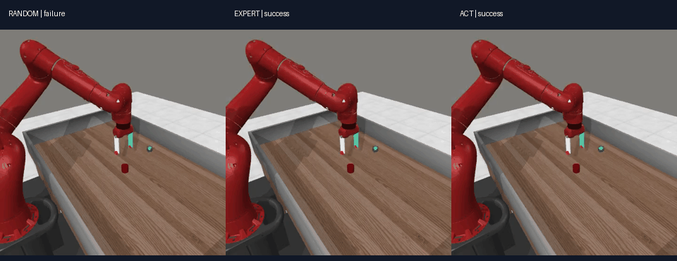
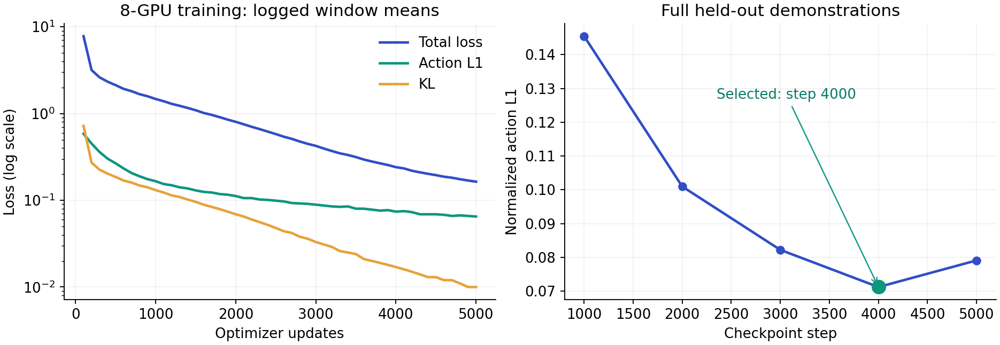
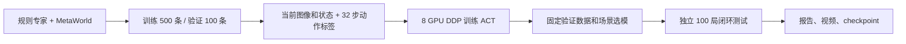

# ACT × MetaWorld：从专家演示到机器人仿真策略

**基于 Hugging Face LeRobot 的具身智能实操项目。** 完成演示采集、数据检查、8 卡 DDP 训练、验证选模与独立闭环测试。选出的 ACT 策略在本次 `push-v3` 的 **100 个独立初始化场景中成功 100 次**。

> 这是 ACT 的工程复现与学习项目。算法及策略核心实现来自 LeRobot，项目工作集中于仿真数据、分布式训练、评测与结果展示。



*三个控制器使用相同初始场景。GIF 为便于观察约放慢至 0.5 倍速；原始 MP4 按采集频率 80 fps 编码。*

[ACT 原始回放](assets/act_push.mp4) · [专家原始回放](assets/expert_push.mp4) · [随机控制原始回放](assets/random_push.mp4)

## 实验结果

| 控制器 | 独立测试成功次数 | 平均执行步数 |
|---|---:|---:|
| 随机动作 | 0 / 100 | 200.00 |
| 规则专家 | 100 / 100 | 61.60 |
| **ACT（step 4000）** | **100 / 100** | **62.13** |

测试条件：单任务 `push-v3`、每局最多 200 步、种子 `300000–300099`。三种控制器初始状态一致性检查通过；测试种子未用于训练、验证或模型选择。这不是 MT50 benchmark，也不代表其他任务或真实机器人的成功率。

[逐局测试报告](results/final_test.json) · [数据划分清单](results/data/) · [模型选择记录](results/model_selection.json) · [训练指标 CSV](results/training_metrics.csv)



训练完成 5000 次更新。step 2000–5000 在固定的 20 个验证场景中均成功 20 次；step 4000 的完整验证集动作 L1 最低，因此选它进行最终测试。**最终测试结果没有参与选模。**

## Pipeline



- **专家**访问仿真内部状态，按规则完成推物块任务；采集器只保留成功演示。
- **学生 ACT**观察单张 RGB 图像和 4 维机器人自身状态，不直接读取物块、目标的坐标。
- **训练**为离线模仿学习，使用动作 L1 与 KL 正则；环境奖励不参与参数更新。
- **推理**每次预测 32 步，执行前 8 步，再根据新观测重新预测。

## 快速体验：直接运行已训练策略

已验证环境为 **Linux、Python 3.12、CUDA 12.6**。演示推理可以使用一张 GPU；也提供 CPU 选项，但 CPU 的完整回放没有作为本次性能基准。

```bash
git clone https://github.com/DJH200202/act-metaworld-demo.git
cd act-metaworld-demo
python3.12 -m venv .venv
source .venv/bin/activate

# Linux 无显示器渲染所需系统库（需要时安装）。
sudo apt-get install -y libosmesa6 ffmpeg

pip install torch==2.7.1 torchvision==0.22.1 \
  --index-url https://download.pytorch.org/whl/cu126
pip install -r requirements.txt
source env.sh
```

从仓库 Release 下载 `act_push_checkpoint.zip`，解压到 `weights/`：

```bash
python scripts/download_checkpoint.py
CUDA_VISIBLE_DEVICES=0 python scripts/replay.py \
  --checkpoint weights/act_push \
  --seed 300000 \
  --output outputs/demo_act
```

输出包括 `report.json` 和任务回放 MP4。重复运行请更换输出目录。

对比随机动作与规则专家（不需要 checkpoint）：

```bash
python scripts/replay.py --mode random --seed 300000 --output outputs/demo_random
python scripts/replay.py --mode expert --seed 300000 --output outputs/demo_expert
```

下载器会校验 SHA-256。若仓库为私有，需要先通过 `gh auth login` 登录；也可以手动下载 Release 附件，并执行：

```bash
python scripts/download_checkpoint.py --archive /path/to/act_push_checkpoint.zip
```

## 从头复现

以下命令均在仓库根目录执行。完整实验使用 8 张 RTX A6000；参数见 [experiment.json](configs/experiment.json)。

```bash
source .venv/bin/activate
source env.sh

# 1. 采集成功演示：500 条训练、100 条验证。
python scripts/collect.py

# 2. 检查数据、32 步动作标签及轨迹边界。
python scripts/inspect_dataset.py --root datasets/push_v2 --chunk-size 32

# 3. 8 卡 DDP，正式训练 5000 次更新。
python scripts/train.py --gpus 0,1,2,3,4,5,6,7
```

也可用 `python scripts/pipeline.py` 从空工作目录串联采集、100 步短验证、正式训练、选模、最终测试。**它会启动真实计算，且拒绝覆盖已有状态和实验目录。** 不要在手动完成上述阶段后重复运行全流程。

单卡小规模接口练习：

```bash
python scripts/collect.py --train-episodes 2 --val-episodes 1 \
  --workers 1 --output datasets/smoke
python scripts/train.py --smoke --gpus 0 \
  --data-root datasets/smoke/train --output outputs/smoke_single_gpu
```

小练习不复现表格中的成功率；单卡每次更新的全局 batch 也与八卡实验不同。

选定模型后，运行独立闭环评测：

```bash
python scripts/evaluate.py \
  --checkpoint outputs/act_ddp5000/checkpoints/004000/pretrained_model \
  --output outputs/my_test \
  --episodes 100 --seed-start 300000 \
  --gpus 0,1,2,3,4,5,6,7 --workers 8 \
  --modes random expert act --skip-validation
```

## 实验配置

| 项目 | 配置 |
|---|---|
| 数据规模 | train 500 条 / 30,735 帧；val 100 条 / 6,086 帧 |
| 数据种子 | train 从 100000 开始；val 从 200000 开始 |
| 选模场景 | 250000–250019，与演示数据种子分离 |
| 观测 | RGB `[3,480,480]` + 末端位置及夹爪开合 `[4]` |
| 动作 | 3 维末端控制量 + 夹爪指令，范围 `[-1,1]` |
| ACT | ResNet18 / dim512 / heads8 / encoder4 / decoder1 |
| 动作序列 | chunk 32，执行 8；潜变量 32，KL 权重 10 |
| 优化 | LR `1e-5`，FP32，每卡 batch8，全局 batch64 |
| 规模 | 51,558,276 参数；8 × RTX A6000 |
| 耗时 | 正式训练约 31 分 41 秒；采集和评测另计 |
| 渲染 | OSMesa CPU 渲染；神经网络训练和推理使用 GPU |

训练指标来自日志窗口均值并保留日志精度；验证动作 L1 使用训练集归一化统计，并按所有有效动作分量加权。图像用 ImageNet 统计量。完整复现实验没有重复多次随机训练种子，因此不能据此报告跨训练种子的均值或方差。

## 代码导航

```text
scripts/collect.py            并行仿真与成功示范保存
scripts/inspect_dataset.py    数据形状、动作和 padding 检查
scripts/train.py              单卡/多卡训练启动入口
scripts/evaluate.py           完整验证集误差与闭环评测
scripts/replay.py             一条命令运行仿真 demo
scripts/pipeline.py           完整实验编排
results/                     已完成实验的可核验报告
assets/                      回放、对比 GIF 和结果图
```

移植后的采集、检查、100 步单卡训练与已训练策略回放均已实测；详见 [验证记录](results/verification.json)。

数据与模型大文件不写入 Git 历史。推理模型通过 Release 提供；演示数据通过采集脚本重建。模型附件包含权重、模型配置和输入/输出处理器统计，不含优化器状态，适合推理，不是完整断点续训包。

## 项目范围与后续方向

目前验证了同一仿真任务、同一初始化分布中的新种子。尚未验证视觉扰动、跨任务泛化、真实机器人迁移，或不同数据量的受控消融。后续可比较数据规模、chunk 长度与闭环执行频率，并增加视觉扰动测试。

用于实习展示的项目表述与技术问答见 [项目说明](docs/PROJECT_NOTES.md)。

## 致谢

- [Hugging Face LeRobot](https://github.com/huggingface/lerobot)：ACT 模型、数据格式和训练框架。
- [ACT 官方教程](https://huggingface.co/docs/lerobot/v0.6.1/en/act)。
- [MetaWorld](https://github.com/Farama-Foundation/Metaworld)：仿真任务和规则专家。

本仓库自有代码采用 MIT License；依赖与预训练权重的许可见 [第三方说明](THIRD_PARTY_NOTICES.md)。
